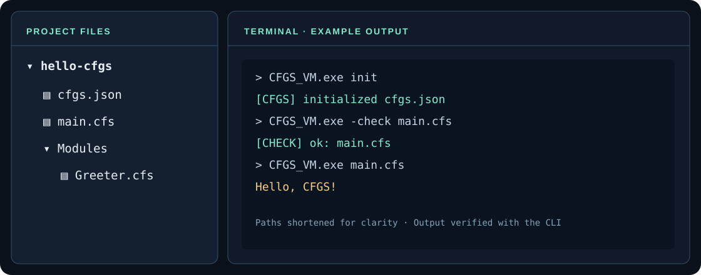

# Your First CFGS Project

This walkthrough starts from the CFGS source repository on Windows. At the end you will have a project folder with a manifest and a working script. The commands below were checked against the current CLI.

> **What `init` does:** It creates `cfgs.json` in the chosen folder. CFGS does not generate `main.cfs` or open a project wizard. You create the source file in the next step.

## 1. Check the prerequisites

Open **PowerShell** in the root of this repository, where `CFGS_VM.sln` is located. You need the **.NET 10 SDK** to build CFGS. VS Code is optional; it is an editor, while the CFGS CLI runs your scripts.

```powershell
dotnet --version
```

The command should report a `10.x` SDK. If it does not run, install the .NET 10 SDK before continuing. The packaged VS Code extension needs the .NET 10 runtime; building CFGS from source needs the SDK.

## 2. Build the CFGS CLI

Run these commands from the repository root:

```powershell
dotnet build .\CFGS_VM.sln -c Release
$cfgsRepo = (Get-Location).Path
$cfgsVm = (Resolve-Path .\dist\Release\net10.0\CFGS_VM.dll).Path
```

`$cfgsVm` is an absolute path to the CLI built here. Keep this PowerShell window open for the remaining steps. The `.dll` is started with `dotnet`; the matching `CFGS_VM.exe` in the same output folder can also be used on Windows.

## 3. Create a project folder and manifest

Choose a location for your own project. This example creates `hello-cfgs` in your user profile, outside the CFGS source repository:

```powershell
$projectDir = Join-Path $env:USERPROFILE 'source\repos\hello-cfgs'
New-Item -ItemType Directory -Path $projectDir -Force | Out-Null
dotnet $cfgsVm init --project $projectDir
Set-Location $projectDir
```

`init` prints the location of `cfgs.json` and the project name. The new manifest starts like this:

```json
{
  "name": "hello-cfgs",
  "version": "0.1.0",
  "plugins": []
}
```

The manifest version is the **project's** version. You can edit it later. There is no lockfile or `.cfgs/plugins` folder until you add and restore a plugin. See [Package and Dependency Management](20_package_dependency_management.md) when you need one.

Create the folder outside any existing CFGS project. If an ancestor already contains `cfgs.json`, `init` uses that project root instead of creating a nested manifest.

## 4. Add the first script

Create `main.cfs` in the project folder. In PowerShell, you can paste this complete command:

```powershell
@'
func main() {
    print("Hello from CFGS");
}

main();
'@ | Set-Content -Path .\main.cfs -Encoding utf8
```

You can also create the file in any text editor. The explicit `main();` call matters: CFGS executes top-level statements, but it does not call a function simply because it is named `main`.

## 5. Check and run it

```powershell
dotnet $cfgsVm -check .\main.cfs
dotnet $cfgsVm .\main.cfs
```

The first command reports `[CHECK] ok` without running the script. The second prints:

```text
Hello from CFGS
```

If you want style diagnostics, run `dotnet $cfgsVm -lint .\main.cfs`. To format the file in place, run `dotnet $cfgsVm -format .\main.cfs --write`.

## 6. Open the project in VS Code (optional)

Install the **CFGS Language Tools** extension from a matching `.vsix` package. This repository contains the extension source in `vscode-cfgs`; [the VS Code guide](13_visual_studio_code_and_lsp.md#install-the-extension-for-a-normal-project) explains how to build and install the package. Then, from the project folder:

```powershell
code .
```

Open `main.cfs`. You should see the CFGS language mode, syntax highlighting, diagnostics, completion, and formatting. Use **View → Command Palette** to run `CFGS: Lint Current File`, `CFGS: Format Current File`, or `CFGS: Restart Language Server`.

The extension provides editing tools. Run the project from a terminal with the CFGS CLI as shown in step 5. If you open a new terminal in VS Code, define `$cfgsVm` there again using the absolute path printed in step 2; PowerShell variables from the first terminal are not carried into a new one.

## 7. Add a module (optional)

Once the first script works, add a separate source file. From the project folder:

```powershell
New-Item -ItemType Directory -Path .\Modules -Force | Out-Null
@'
namespace Hello.App {
    class Greeter(person) {
        property prefix { get; set; } = "Hello";
        func message() { return this.prefix + ", " + this.person + "!"; }
    }
}
'@ | Set-Content -Path .\Modules\Greeter.cfs -Encoding utf8
```

Replace `main.cfs` with:

```cfs
import "Modules/Greeter.cfs";

var greeter = new Hello.App.Greeter("CFGS");
print(greeter.message());
```

Run `dotnet $cfgsVm -check .\main.cfs` and `dotnet $cfgsVm .\main.cfs` again. The result is `Hello, CFGS!`. The import is resolved relative to `main.cfs`, so the folder name and capitalization in the import must match your files. For more on classes and imports, read [Classes and Namespaces](06_classes_enums_namespaces_and_inheritance.md) and [Modules and Imports](07_modules_imports_and_exports.md).

Your project now looks like this:

```text
hello-cfgs/
├── cfgs.json
├── main.cfs
└── Modules/
    └── Greeter.cfs
```



*Illustration of the verified command output after adding the module. Your absolute paths will differ.*

## If something does not work

| Symptom | Check |
| --- | --- |
| `dotnet` is unavailable | Install the .NET 10 SDK and reopen PowerShell. |
| `CFGS_VM.dll` cannot be found | Build the solution from the repository root and check the path in `$cfgsVm`. |
| `import path not found` | Check the path relative to the importing `.cfs` file and open the project folder itself in VS Code. |
| `.cfs` has no highlighting | Check that CFGS Language Tools is installed and that VS Code recognizes the file as CFGS. |
| The terminal prints nothing | Check that `main();` is present, or put a `print(...)` statement at top level. |
| The linter warns about tabs (`CFGS8002`) | Use spaces or deliberately configure both the formatter and linter for tabs. See [VS Code settings](13_visual_studio_code_and_lsp.md#optional-vs-code-settings). |

For CLI options, working-directory rules, tests, REPL use, and compiled `.cfb` files, continue with [Getting Started and Running Scripts](01_getting_started_and_running.md).
